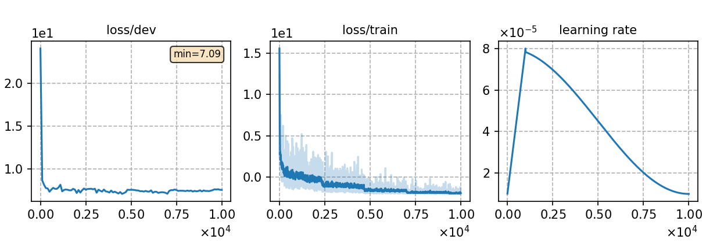

### Basic info

**This part is auto-generated, add your details in Appendix**

* \# of parameters (million): 411.04
* GPU info \[4\]
  * \[4\] NVIDIA H100 80GB HBM3

### Notes

* 

### Result
```
test_ASRU2019_jnl_lower %SER 70.43 | %MER 13.83 [ 27549 / 199127, 5167 ins, 1291 del, 21091 sub ]
test_ASRU2019_jnl_lower %SER 60.09 | %CER 9.44 [ 29083 / 307972, 3261 ins, 4811 del, 21011 sub ]

```

|     training process    |
|:-----------------------:|
||
