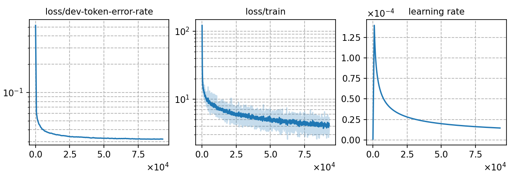

### Basic info

**This part is auto-generated, add your details in Appendix**

* \# of parameters (million): 115.41
* GPU info \[4\]
  * \[4\] NVIDIA H100 80GB HBM3

### Notes

* 

### Result
```
# best-3 small class decoding
test_ASRU2019_jnl       %SER 98.26 | %PER 21.97 [ 117347 / 534181, 68021 ins, 3575 del, 45751 sub ]
dev_ASRU2019_jnl        %SER 97.79 | %PER 12.12 [ 147417 / 1216302, 9120 ins, 11475 del, 126822 sub ]

# best-3 small class sampling
train_ASRU2019_jnl      %SER 96.28 | %PER 11.14 [ 632161 / 5675554, 29075 ins, 13390 del, 589696 sub ]
```

|     training process    |
|:-----------------------:|
||
