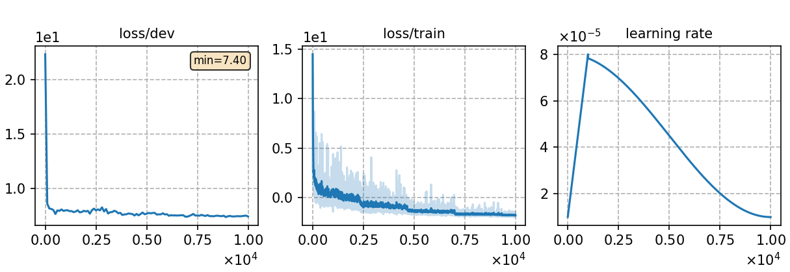

### Basic info

**This part is auto-generated, add your details in Appendix**

* \# of parameters (million): 411.04
* GPU info \[4\]
  * \[4\] NVIDIA H100 80GB HBM3

### Notes

* 

### Result
```
test_ASRU2019_jnl_lower %SER 70.20 | %MER 13.69 [ 27265 / 199127, 4900 ins, 1394 del, 20971 sub ]
test_ASRU2019_jnl_lower %SER 60.00 | %CER 9.60 [ 29572 / 307972, 3282 ins, 5228 del, 21062 sub ]
```

|     training process    |
|:-----------------------:|
||
