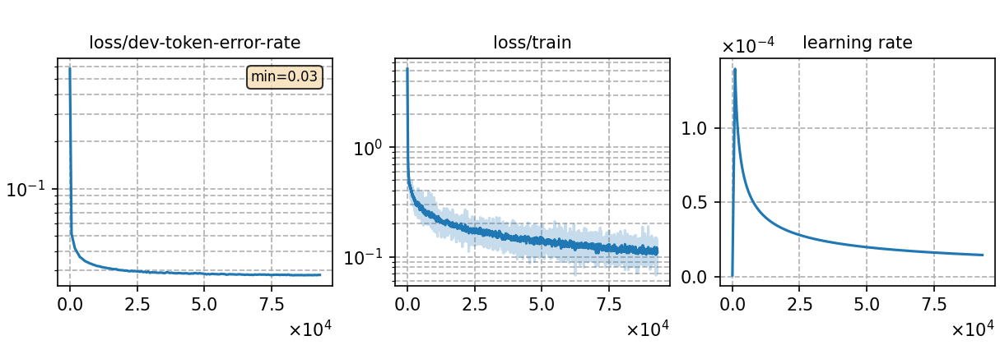

### Basic info

**This part is auto-generated, add your details in Appendix**

* \# of parameters (million): 115.41
* GPU info \[4\]
  * \[4\] NVIDIA H100 80GB HBM3

### Notes

* 

### Dev metric: non-tonal PER

This experiment is trained with `cat.ctc.train_mnt_nontonal`, which reports
**dev non-tonal PER (NT-PER)**: before scoring, the decoded phoneme ids and the
reference ids are both mapped from tone-marked subclasses onto their base vowels.
The dev curve in `monitor.png` is therefore measured in the same base-vowel space
as the Latent Softmax counterpart, so the two training curves are comparable.

If you prefer the ordinary (tone-marked) dev PER, switch the trainer back:

* in `hyper-p.json`, set `train:bin` to `cat.ctc.train` (that is the only
  difference between the two entry points);
* remove `train:option:sub2base`, it is only used for the mapping;
* if `inference.infer.option.built-model-by` points at
  `cat.ctc.train_mnt_nontonal`, point it at `cat.ctc.train` as well.

The numbers under `### Result` below come from the separate `inference:er`
stage, not from the training-time dev curve.

### `sub2base` file

`cat.ctc.train_mnt_nontonal` requires `train:option:sub2base`: a JSON object
mapping every tone-marked phoneme id to the id of its base vowel. Example (ids
are illustrative):

```json
{
    "77": 81,
    "78": 81,
    "79": 81,
    "80": 82
}
```

* keys: ids in the tokenizer vocabulary named by `tokenizer.file` (a `.tknz`
  pickle created by `cat/shared/tokenizer.py`);
* values: the matching base-vowel ids in the same vocabulary;
* ids that are not listed are used unchanged, so consonants and the CTC blank
  need no entry.

For this experiment the file is generated from the same tokenizer by
`egs/latent-softmax/local/majorClass2subClass.py`:

```bash
python local/majorClass2subClass.py \
    data/ASRU2019_jnl/tokenizer.tknz \
    --out data/ASRU2019_jnl/baseline_sub2base.json
```

The file is a data asset, not part of the repository.

### Result
```
test_ASRU2019_jnl       %SER 71.87 | %PER 16.64 [ 88451 / 531483, 66033 ins, 2600 del, 19818 sub ]
dev_ASRU2019_jnl        %SER 47.94 | %PER 3.47 [ 41907 / 1208161, 5927 ins, 9023 del, 26957 sub ]

sample:
train_ASRU2019_jnl      %SER 5.51 | %PER 0.31 [ 17282 / 5642632, 2890 ins, 7035 del, 7357 sub ]
```

|     training process    |
|:-----------------------:|
||
