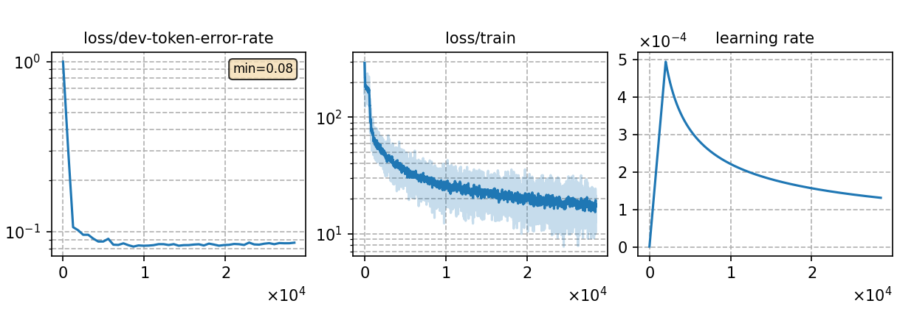

### Basic info

**This part is auto-generated, add your details in Appendix**

* \# of parameters (million): 115.41
* GPU info \[8\]
  * \[8\] NVIDIA H100 80GB HBM3

### Notes

* 

### Result
```
cs_dialog_test  %SER 79.94 | %PER 23.82 [ 120122 / 504283, 22973 ins, 14278 del, 82871 sub ]
cs_dialog_dev   %SER 78.34 | %PER 20.20 [ 109256 / 540780, 10101 ins, 14985 del, 84170 sub ]
cs_dialog_test  %SER 71.66 | %NT-PER 11.67 [ 58841 / 504283, 23422 ins, 14727 del, 20692 sub ]
cs_dialog_dev   %SER 69.58 | %NT-PER 7.84 [ 42392 / 540780, 10444 ins, 15328 del, 16620 sub ]
```

|     training process    |
|:-----------------------:|
||
