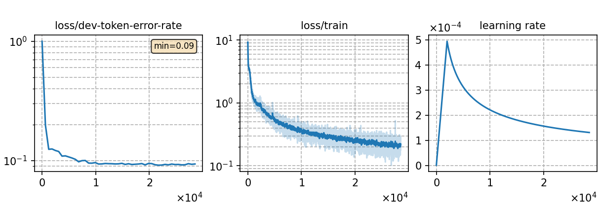

### Basic info

**This part is auto-generated, add your details in Appendix**

* \# of parameters (million): 115.41
* GPU info \[8\]
  * \[8\] NVIDIA L40S

### Notes

* 

### Dev metric: non-tonal PER

This experiment is trained with `cat.ctc.train_mnt_nontonal`, which reports
**dev non-tonal PER (NT-PER)**: before scoring, the decoded phoneme ids and the
reference ids are both mapped from tone-marked subclasses onto their base vowels.
The dev curve in `monitor.png` is therefore measured in the same base-vowel space
as the Latent Softmax counterpart, so the two training curves are comparable.

If you prefer the ordinary (tone-marked) dev PER, switch the trainer back:

* in `hyper-p.json`, set `train:bin` to `cat.ctc.train` (that is the only
  difference between the two entry points);
* remove `train:option:sub2base`, it is only used for the mapping;
* `inference.infer.option.built-model-by` currently points at
  `cat.ctc.train_mnt_nontonal`; point it at `cat.ctc.train` as well.

The numbers under `### Result` below come from the separate `inference:er`
stage, not from the training-time dev curve.

### `sub2base` file

`cat.ctc.train_mnt_nontonal` requires `train:option:sub2base`: a JSON object
mapping every tone-marked phoneme id to the id of its base vowel. Example (ids
are illustrative):

```json
{
    "77": 81,
    "78": 81,
    "79": 81,
    "80": 82
}
```

* keys: ids in the tokenizer vocabulary named by `tokenizer.file` (a `.tknz`
  pickle created by `cat/shared/tokenizer.py`);
* values: the matching base-vowel ids in the same vocabulary;
* ids that are not listed are used unchanged, so consonants and the CTC blank
  need no entry.

For this experiment the file is generated from the same tokenizer by
`egs/latent-softmax/local/majorClass2subClass.py`:

```bash
python local/majorClass2subClass.py \
    data/CS-Dialogue/tokenizer_extend_test_oov.tknz \
    --out data/CS-Dialogue/baseline_sub2base.json
```

The file is a data asset, not part of the repository.

### Result
```
cs_dialog_test  %SER 71.26 | %PER 10.73 [ 55468 / 517051, 11676 ins, 15814 del, 27978 sub ]
cs_dialog_dev   %SER 69.64 | %PER 9.41 [ 50907 / 540780, 10510 ins, 15651 del, 24746 sub ]
cs_dialog_test  %SER 69.62 | %NT-PER 9.66 [ 49952 / 517051, 11756 ins, 15894 del, 22302 sub ]
cs_dialog_dev   %SER 68.28 | %NT-PER 8.45 [ 45692 / 540780, 10607 ins, 15748 del, 19337 sub ]
```

|     training process    |
|:-----------------------:|
||
