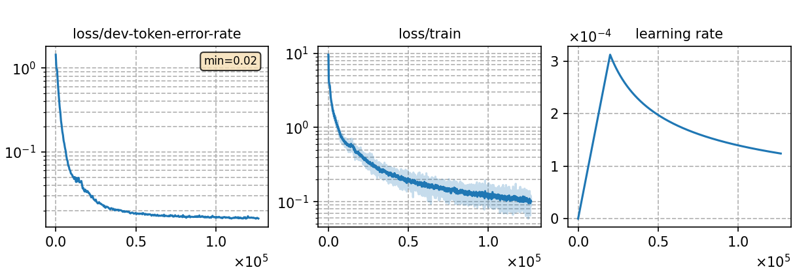

### Basic info

**This part is auto-generated, add your details in Appendix**

* \# of parameters (million): 115.40
* GPU info \[8\]
  * \[8\] NVIDIA GeForce RTX 3090

### Notes

* 

### Result
```
# 174 epoch best 10
test_aishell    %SER 33.31 | %PER 1.68 [ 4747 / 281745, 457 ins, 617 del, 3673 sub ]

# 221 epoch best 10
test_aishell    %SER 32.27 | %PER 1.66 [ 4669 / 281745, 424 ins, 604 del, 3641 sub ]
test_aishell_ac1.0_lm0.9_wip0.0.hyp     %SER 39.10 | %CER 5.64 [ 5910 / 104730, 66 ins, 186 del, 5658 sub ]


```

|     training process    |
|:-----------------------:|
||
