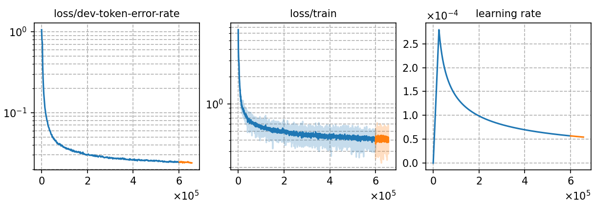

### Basic info

**This part is auto-generated, add your details in Appendix**

* \# of parameters (million): 115.41
* GPU info \[8\]
  * \[8\] NVIDIA GeForce RTX 3090

### Notes

* 

### Result
```
# 312 epoch  best 3
test-clean-libri        %SER 42.60 | %PER 1.28 [ 2663 / 208519, 455 ins, 809 del, 1399 sub ]
test-other-libri        %SER 71.59 | %PER 4.15 [ 8360 / 201402, 1351 ins, 2414 del, 4595 sub ]

# change 600k step to 655000 step
# 376 epoch  best 3
test-clean-libri        %SER 41.18 | %PER 1.21 [ 2529 / 208519, 439 ins, 765 del, 1325 sub ]
test-other-libri        %SER 69.92 | %PER 4.04 [ 8129 / 201402, 1331 ins, 2375 del, 4423 sub ]

# 410 epoch  best 3
test-clean-libri        %SER 40.50 | %PER 1.22 [ 2548 / 208519, 439 ins, 784 del, 1325 sub ]
test-other-libri        %SER 69.75 | %PER 3.94 [ 7930 / 201402, 1314 ins, 2318 del, 4298 sub ]

# 410 epoch  best 10
test-clean-libri        %SER 40.69 | %PER 1.20 [ 2507 / 208519, 436 ins, 754 del, 1317 sub ]
test-other-libri        %SER 69.51 | %PER 3.87 [ 7789 / 201402, 1301 ins, 2233 del, 4255 sub ]
test-clean-libri_ac1.0_lm1.1_wip0.0.hyp %SER 34.73 | %WER 3.22 [ 1694 / 52576, 243 ins, 149 del, 1302 sub ]                                                                          
test-other-libri_ac1.0_lm1.3_wip0.0.hyp %SER 56.04 | %WER 7.17 [ 3751 / 52343, 441 ins, 425 del, 2885 sub ]                                                                          

```

|     training process    |
|:-----------------------:|
||
