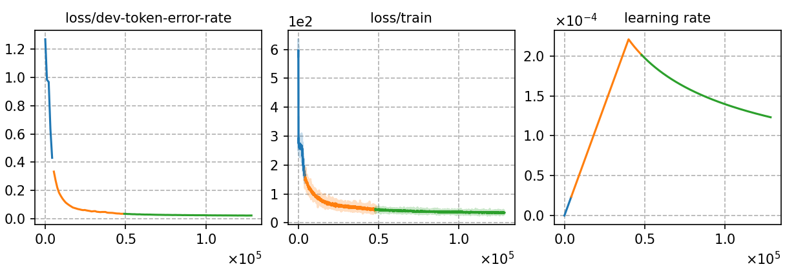

### Basic info

**This part is auto-generated, add your details in Appendix**

* \# of parameters (million): 115.41
* GPU info \[4\]
  * \[4\] NVIDIA H100 80GB HBM3

### Notes

* 

### Result
```

300 epoch best-10
test_aishell    %SER 36.49 | %PER 1.81 [ 5087 / 281745, 448 ins, 597 del, 4042 sub ]
test-clean-libri        %SER 43.09 | %PER 1.34 [ 2796 / 208519, 542 ins, 804 del, 1450 sub ]
test-other-libri        %SER 71.59 | %PER 4.37 [ 8795 / 201402, 1610 ins, 2330 del, 4855 sub ]
test-clean-libri        %SER 53.55 | %NT-PER 1.66 [ 3466 / 208519, 1214 ins, 781 del, 1471 sub ]
test-other-libri        %SER 76.49 | %NT-PER 4.76 [ 9577 / 201402, 2399 ins, 2266 del, 4912 sub ]
```

|     training process    |
|:-----------------------:|
||
