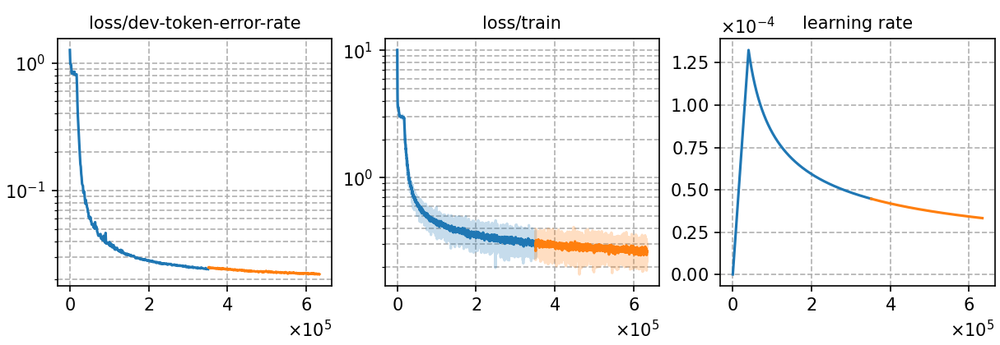

### Basic info

**This part is auto-generated, add your details in Appendix**

* \# of parameters (million): 115.41
* GPU info \[8\]
  * \[8\] NVIDIA A800-SXM4-80GB

### Notes

* 

### Result
```

# 123 epoch best-3
test_aishell    %SER 78.52 | %PER 3.72 [ 10481 / 281745, 4909 ins, 749 del, 4823 sub ]
test-clean-libri        %SER 67.63 | %PER 2.82 [ 5883 / 208519, 1036 ins, 1683 del, 3164 sub ]
test-other-libri        %SER 85.64 | %PER 7.59 [ 15285 / 201402, 2559 ins, 4079 del, 8647 sub ]

# 309 epoch best-3
test_aishell    %SER 52.08 | %PER 2.41 [ 6802 / 281745, 2009 ins, 661 del, 4132 sub ]
test-clean-libri        %SER 55.53 | %PER 1.93 [ 4026 / 208519, 769 ins, 1120 del, 2137 sub ]
test-other-libri        %SER 80.06 | %PER 5.78 [ 11646 / 201402, 2004 ins, 3078 del, 6564 sub ]

# 405 epoch best-3
test_aishell    %SER 42.47 | %PER 2.04 [ 5756 / 281745, 1028 ins, 699 del, 4029 sub ]
test-clean-libri        %SER 53.40 | %PER 1.80 [ 3743 / 208519, 650 ins, 1087 del, 2006 sub ]
test-other-libri        %SER 78.70 | %PER 5.48 [ 11032 / 201402, 1835 ins, 3048 del, 6149 sub ]

# 521 epoch best-3
test_aishell    %SER 41.16 | %PER 2.01 [ 5671 / 281745, 906 ins, 718 del, 4047 sub ]
test-clean-libri        %SER 51.64 | %PER 1.68 [ 3508 / 208519, 621 ins, 1010 del, 1877 sub ]
test-other-libri        %SER 76.39 | %PER 5.12 [ 10315 / 201402, 1747 ins, 2820 del, 5748 sub ]

# 600 epoch best-10
test_aishell    %SER 42.74 | %PER 2.03 [ 5707 / 281745, 1112 ins, 701 del, 3894 sub ]
test-clean-libri        %SER 50.80 | %PER 1.60 [ 3337 / 208519, 607 ins, 941 del, 1789 sub ]
test-other-libri        %SER 75.77 | %PER 5.00 [ 10063 / 201402, 1697 ins, 2763 del, 5603 sub ]
dev_aishell     %SER 34.49 | %PER 1.70 [ 9370 / 552108, 1603 ins, 1272 del, 6495 sub ]
dev-clean-libri %SER 49.57 | %PER 1.60 [ 3405 / 213067, 616 ins, 912 del, 1877 sub ]
dev-other-libri %SER 75.17 | %PER 5.40 [ 10619 / 196691, 1667 ins, 2789 del, 6163 sub ]

```

|     training process    |
|:-----------------------:|
||
