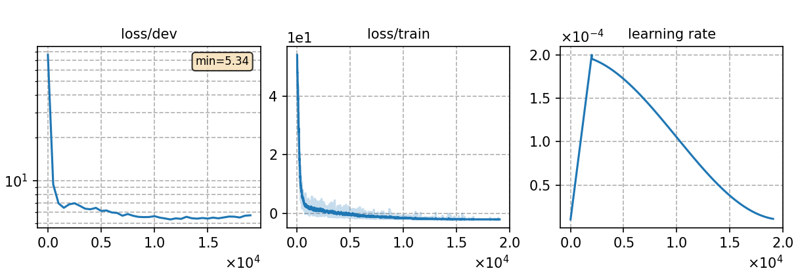

### Basic info

**This part is auto-generated, add your details in Appendix**

* \# of parameters (million): 411.04
* GPU info \[4\]
  * \[4\] NVIDIA H800

### Notes

* 

### Result
```

test_aishell_nospace	%SER 37.84 | %CER 5.40 [ 5653 / 104730, 160 ins, 281 del, 5212 sub ]

```

|     training process    |
|:-----------------------:|
||
