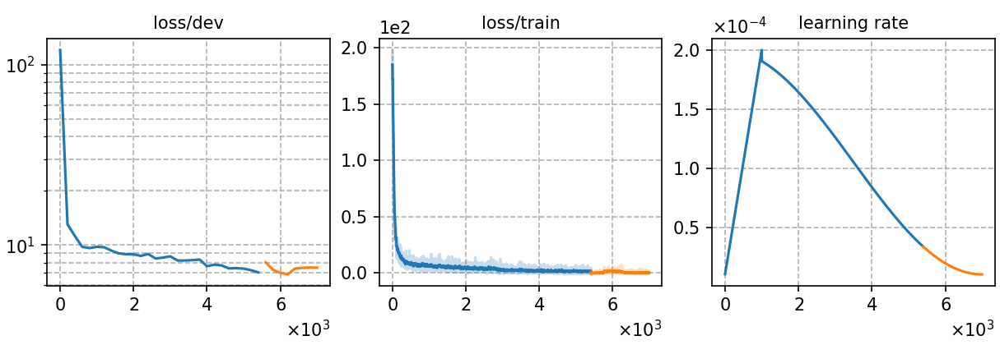

### Basic info

**This part is auto-generated, add your details in Appendix**

* \# of parameters (million): 411.04
* GPU info \[4\]
  * \[4\] NVIDIA H800

### Notes

* 

### Result
```

test-clean-libri_lower	%SER 39.54 | %WER 4.12 [ 2165 / 52576, 273 ins, 262 del, 1630 sub ]
test-other-libri_lower	%SER 62.98 | %WER 9.47 [ 4959 / 52343, 627 ins, 568 del, 3764 sub ]

```

|     training process    |
|:-----------------------:|
||
