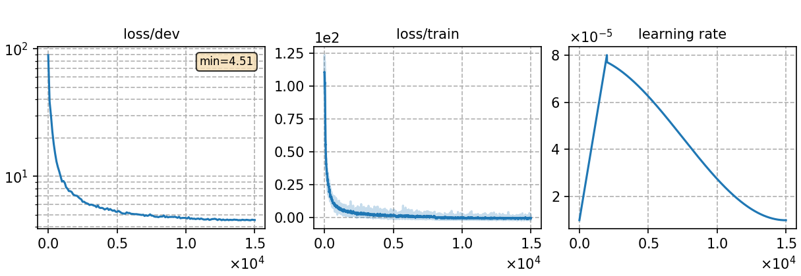

### Basic info

**This part is auto-generated, add your details in Appendix**

* \# of parameters (million): 411.04
* GPU info \[4\]
  * \[4\] NVIDIA H100 80GB HBM3

### Notes

* 

### Result
```
test_aishell_nospace    %SER 37.50 | %CER 5.57 [ 5836 / 104730, 265 ins, 527 del, 5044 sub ]
test-clean-libri_lower  %SER 38.93 | %WER 4.21 [ 2213 / 52576, 302 ins, 270 del, 1641 sub ]
test-other-libri_lower  %SER 63.29 | %WER 9.80 [ 5132 / 52343, 599 ins, 589 del, 3944 sub ]
```

|     training process    |
|:-----------------------:|
||
