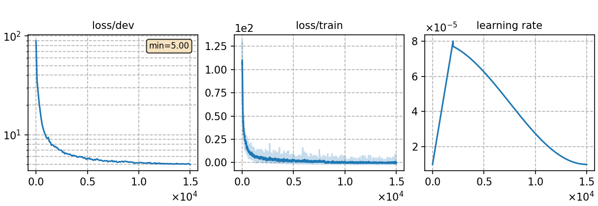

### Basic info

**This part is auto-generated, add your details in Appendix**

* \# of parameters (million): 411.04
* GPU info \[8\]
  * \[8\] NVIDIA H100 80GB HBM3

### Notes

* 

### Result
```

test_aishell_nospace    %SER 38.64 | %CER 5.63 [ 5899 / 104730, 228 ins, 464 del, 5207 sub ]
test-clean-libri_lower  %SER 41.49 | %WER 4.29 [ 2253 / 52576, 280 ins, 253 del, 1720 sub ]
test-other-libri_lower  %SER 65.06 | %WER 10.70 [ 5600 / 52343, 676 ins, 640 del, 4284 sub ]


```

|     training process    |
|:-----------------------:|
||
