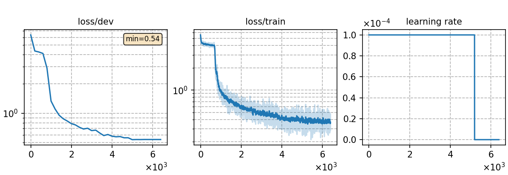

### Basic info

**This part is auto-generated, add your details in Appendix**

* \# of parameters (million): 18.88
* GPU info \[8\]
  * \[8\] NVIDIA H100 80GB HBM3

### Notes

* 

### Result
```
# s2p temp 2.0 best-3
test_aishell_nospace    %SER 54.38 | %CER 9.31 [ 9748 / 104730, 820 ins, 1200 del, 7728 sub ]
test-clean-libri_lower  %SER 55.27 | %WER 5.91 [ 3108 / 52576, 305 ins, 264 del, 2539 sub ]
test-other-libri_lower  %SER 72.10 | %WER 11.91 [ 6233 / 52343, 667 ins, 625 del, 4941 sub ]

test_aishell_nospace    %SER 63.83 | %CER 13.39 [ 14026 / 104730, 2005 ins, 1994 del, 10027 sub ]
test-clean-libri_lower  %SER 60.99 | %WER 6.91 [ 3631 / 52576, 348 ins, 314 del, 2969 sub ]
test-other-libri_lower  %SER 76.32 | %WER 13.21 [ 6913 / 52343, 675 ins, 767 del, 5471 sub ]
```

|     training process    |
|:-----------------------:|
||
