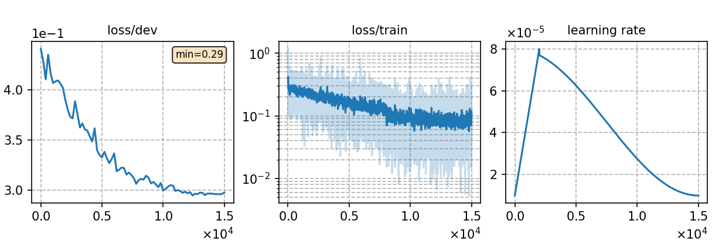

### Basic info

**This part is auto-generated, add your details in Appendix**

* \# of parameters (million): 557.84
* GPU info \[8\]
  * \[8\] NVIDIA H100 80GB HBM3

### Notes

* 

### Result
```

test_aishell_nospace    %SER 38.47 | %CER 5.61 [ 5876 / 104730, 297 ins, 564 del, 5015 sub ]
test-clean-libri_lower  %SER 40.76 | %WER 3.92 [ 2062 / 52576, 218 ins, 279 del, 1565 sub ]
test-other-libri_lower  %SER 62.64 | %WER 9.61 [ 5028 / 52343, 515 ins, 690 del, 3823 sub ]
```

|     training process    |
|:-----------------------:|
||
