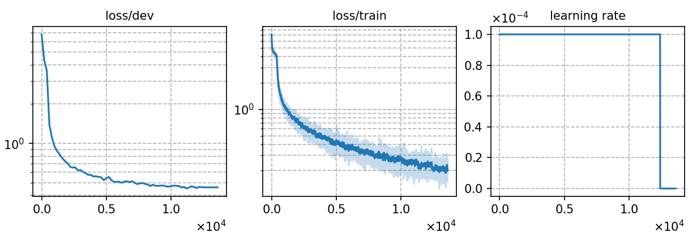

### Basic info

**This part is auto-generated, add your details in Appendix**

* \# of parameters (million): 18.88
* GPU info \[4\]
  * \[4\] NVIDIA H100 80GB HBM3

### Notes

* 

### Result
```
test_aishell_nospace    %SER 46.43 | %CER 7.23 [ 7575 / 104730, 608 ins, 1045 del, 5922 sub ]

```

|     training process    |
|:-----------------------:|
||
