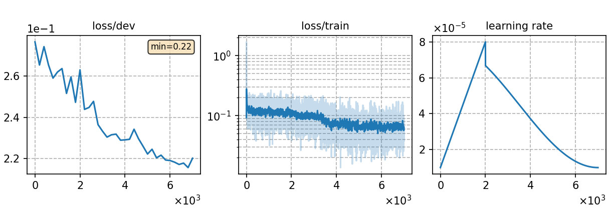

### Basic info

**This part is auto-generated, add your details in Appendix**

* \# of parameters (million): 411.04
* GPU info \[4\]
  * \[4\] NVIDIA H100 80GB HBM3

### Notes

* 

### Result
```
2 epoch
test-clean-libri_lower  %SER 37.18 | %WER 3.29 [ 1729 / 52576, 175 ins, 186 del, 1368 sub ]
test-other-libri_lower  %SER 60.84 | %WER 8.24 [ 4314 / 52343, 411 ins, 569 del, 3334 sub ]
```

|     training process    |
|:-----------------------:|
||
