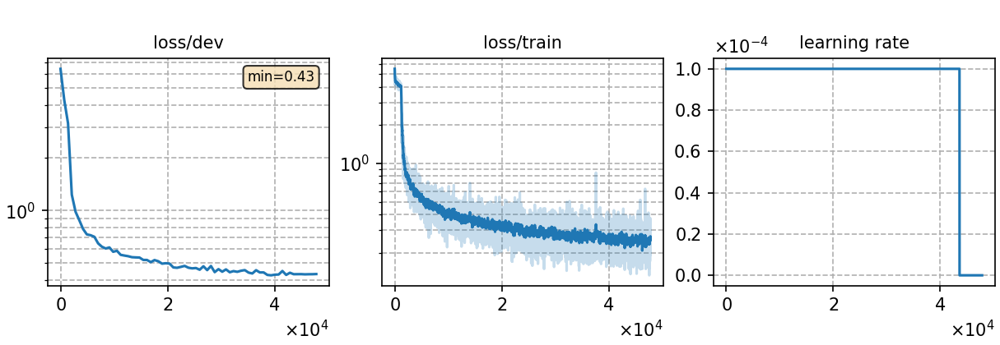

### Basic info

**This part is auto-generated, add your details in Appendix**

* \# of parameters (million): 18.88
* GPU info \[2\]
  * \[2\] NVIDIA H100 80GB HBM3

### Notes

* 

### Result
```
test_aishell_nospace    %SER 54.42 | %CER 9.40 [ 9843 / 104730, 1060 ins, 1424 del, 7359 sub ]
test-clean-libri_lower  %SER 48.70 | %WER 4.78 [ 2513 / 52576, 221 ins, 241 del, 2051 sub ]
test-other-libri_lower  %SER 67.74 | %WER 10.33 [ 5407 / 52343, 538 ins, 592 del, 4277 sub ]
```

|     training process    |
|:-----------------------:|
||
