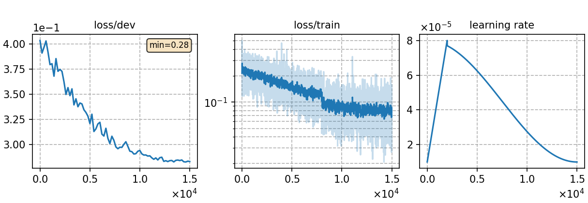

### Basic info

**This part is auto-generated, add your details in Appendix**

* \# of parameters (million): 411.04
* GPU info \[2\]
  * \[2\] NVIDIA H100 80GB HBM3

### Notes

* 

### Result
```
test_aishell_nospace    %SER 38.67 | %CER 5.52 [ 5786 / 104730, 334 ins, 681 del, 4771 sub ]
test-clean-libri_lower  %SER 39.16 | %WER 3.63 [ 1911 / 52576, 197 ins, 236 del, 1478 sub ]
test-other-libri_lower  %SER 60.33 | %WER 9.14 [ 4784 / 52343, 451 ins, 776 del, 3557 sub ]
```

|     training process    |
|:-----------------------:|
||
