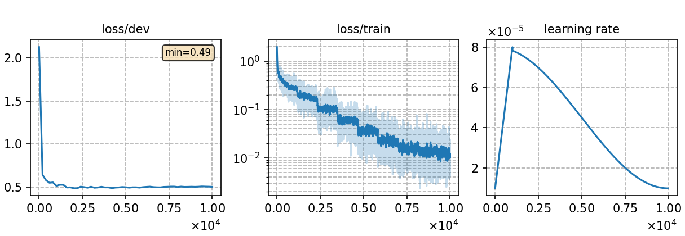

### Basic info

**This part is auto-generated, add your details in Appendix**

* \# of parameters (million): 411.04
* GPU info \[4\]
  * \[4\] NVIDIA H100 80GB HBM3

### Notes

* 

### Result
```
test_ASRU2019_jnl_lower %SER 70.91 | %MER 14.08 [ 28046 / 199127, 5059 ins, 1496 del, 21491 sub ]
test_ASRU2019_jnl_lower %SER 60.76 | %CER 9.73 [ 29978 / 307972, 3575 ins, 4858 del, 21545 sub ]

```

|     training process    |
|:-----------------------:|
||
