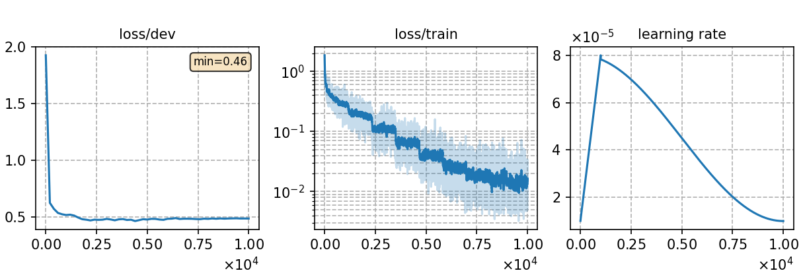

### Basic info

**This part is auto-generated, add your details in Appendix**

* \# of parameters (million): 411.04
* GPU info \[4\]
  * \[4\] NVIDIA H100 80GB HBM3

### Notes

* 

### Result
```
test_ASRU2019_jnl_lower %SER 70.31 | %MER 13.71 [ 27299 / 199127, 5031 ins, 1453 del, 20815 sub ]
test_ASRU2019_jnl_lower %SER 59.92 | %CER 9.42 [ 29025 / 307972, 3590 ins, 4666 del, 20769 sub ]
```

|     training process    |
|:-----------------------:|
||
