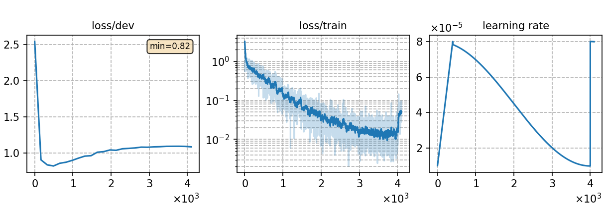

### Basic info

**This part is auto-generated, add your details in Appendix**

* \# of parameters (million): 411.04
* GPU info \[8\]
  * \[8\] NVIDIA L40S

### Notes

* 

### Result
```
cs_dialog_test_lower    %SER 69.22 | %MER 15.53 [ 28164 / 181304, 3360 ins, 5443 del, 19361 sub ]
cs_dialog_test_lower    %SER 69.14 | %CER 14.91 [ 44627 / 299320, 9116 ins, 12174 del, 23337 sub ]
```

|     training process    |
|:-----------------------:|
||
