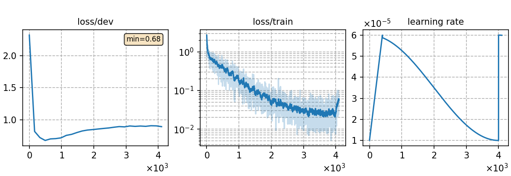

### Basic info

**This part is auto-generated, add your details in Appendix**

* \# of parameters (million): 411.04
* GPU info \[8\]
  * \[8\] NVIDIA L40S

### Notes

* 

### Result
```
cs_dialog_test_lower    %SER 68.83 | %MER 14.06 [ 25488 / 181304, 2798 ins, 5580 del, 17110 sub ]
cs_dialog_test_lower    %SER 68.75 | %CER 13.72 [ 41059 / 299320, 8373 ins, 11967 del, 20719 sub ]
```

|     training process    |
|:-----------------------:|
||
